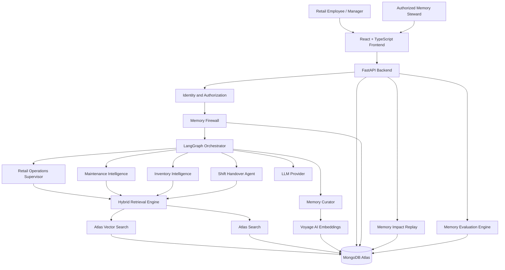
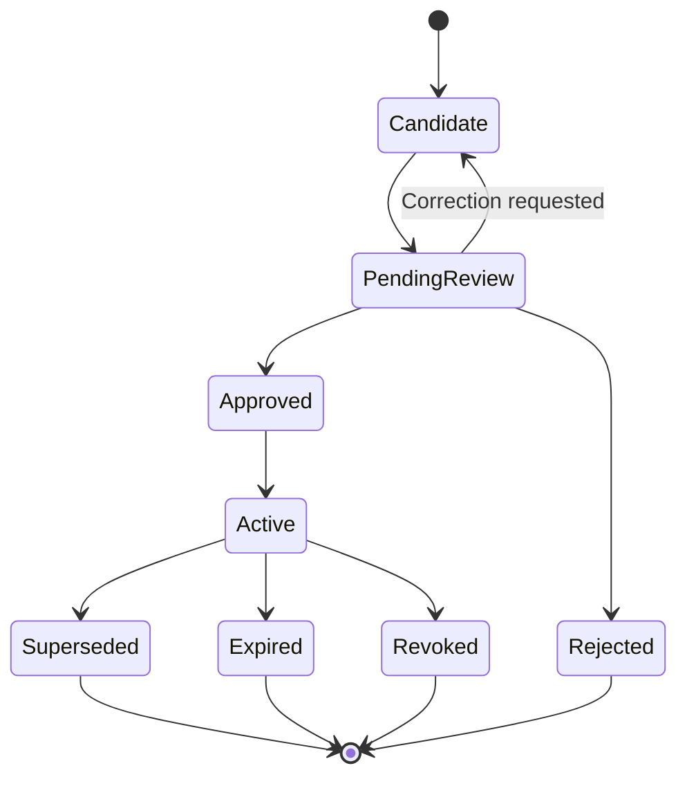
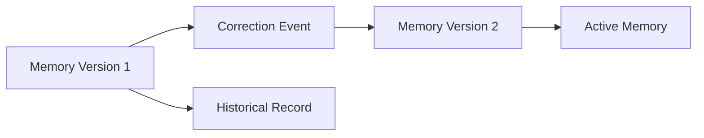
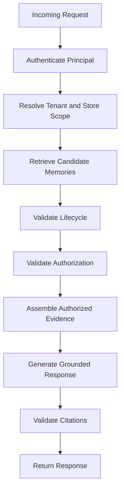
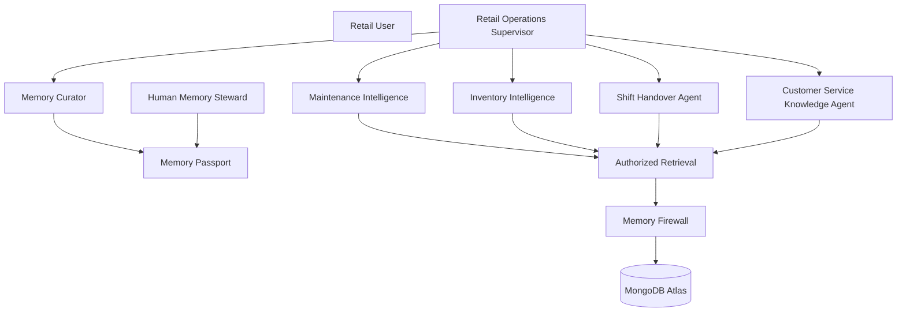
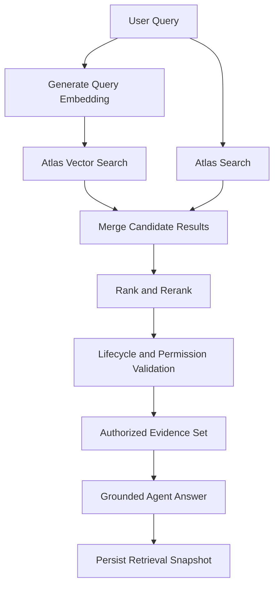
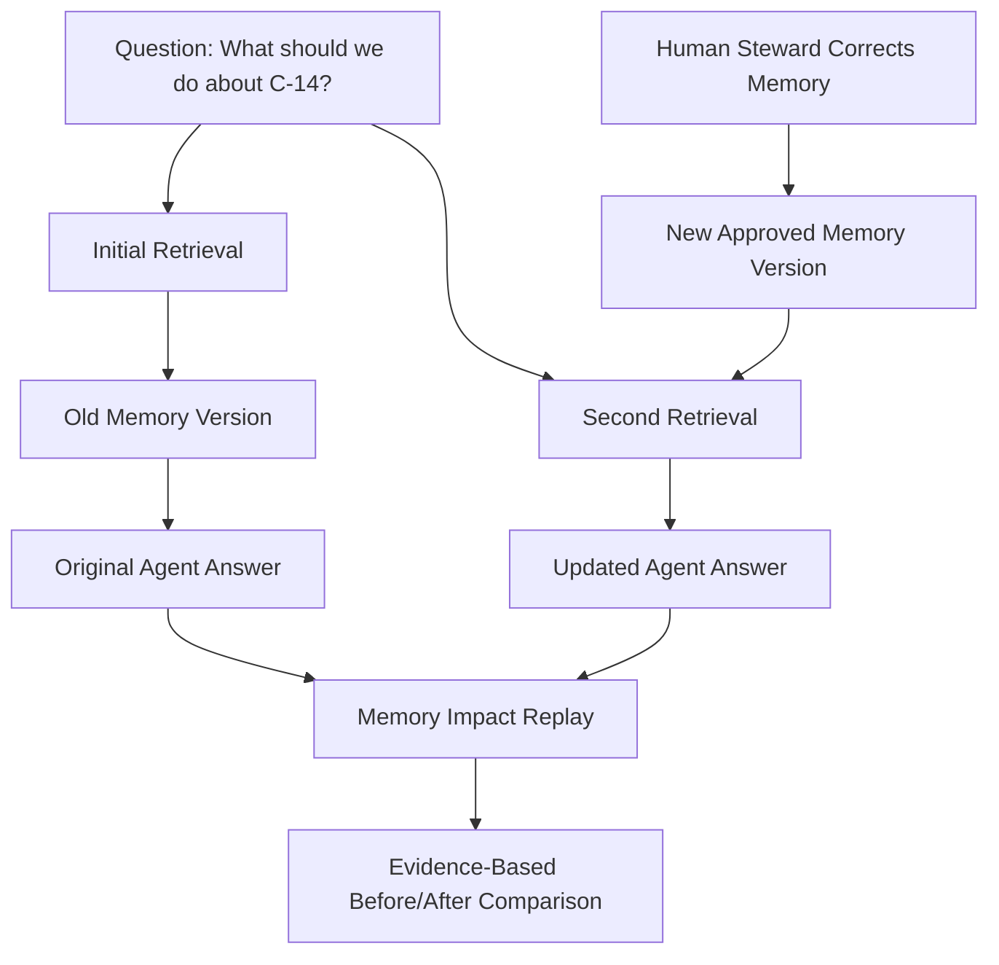
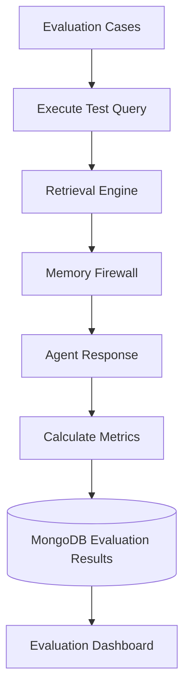
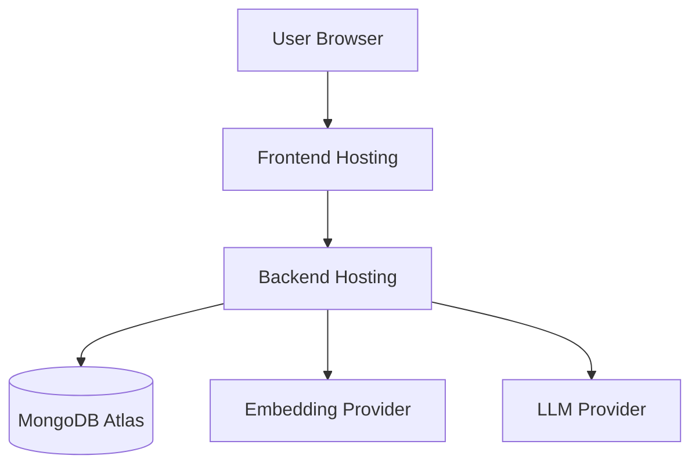

# CONTEXT RETAIL
## The Governed Memory Platform for AI-Powered Retail Operations

**Remember with evidence. Retrieve with permission. Evolve with control.**


---

# Table of Contents

1. [Executive Overview](#1-executive-overview)
2. [The Problem](#2-the-problem)
3. [Our Solution](#3-our-solution)
4. [Product Vision and Design Principles](#4-product-vision-and-design-principles)
5. [System Architecture](#5-system-architecture)
6. [MongoDB Atlas Architecture](#6-mongodb-atlas-architecture)
7. [Memory Passport](#7-memory-passport)
8. [Memory Lifecycle and Evolution Engine](#8-memory-lifecycle-and-evolution-engine)
9. [Memory Firewall and Security](#9-memory-firewall-and-security)
10. [AI Agent Architecture](#10-ai-agent-architecture)
11. [Hybrid Retrieval Architecture](#11-hybrid-retrieval-architecture)
12. [Memory Impact Replay](#12-memory-impact-replay)
13. [Memory Evaluation Engine](#13-memory-evaluation-engine)
14. [Retail Demo Environment](#14-retail-demo-environment)
15. [Application Interface](#15-application-interface)
16. [Backend Architecture and API](#16-backend-architecture-and-api)
17. [Technology Stack](#17-technology-stack)
18. [Installation and Configuration](#18-installation-and-configuration)
19. [Testing, Security, and Deployment](#19-testing-security-and-deployment)
20. [Demo, Roadmap, and Impact](#20-demo-roadmap-and-impact)

---

# 1. Executive Overview

## What is CONTEXT RETAIL?

CONTEXT RETAIL is a governed operational memory platform designed for AI agents working in multi-location retail environments.

Retail organizations generate enormous amounts of operational knowledge:

- Maintenance procedures.
- Equipment incident reports.
- Inventory discrepancies.
- Store policies.
- Employee shift handovers.
- Vendor instructions.
- Safety procedures.
- Operational decisions.
- Historical troubleshooting records.

This information is valuable, but it is frequently fragmented across documents, systems, employees, and locations.

An AI agent can retrieve information from these sources, but retrieval alone does not guarantee that the information is accurate, current, authorized, or applicable.

CONTEXT RETAIL introduces a governance layer between organizational knowledge and AI agents.

It gives every operational memory a verifiable identity, source, owner, scope, version, approval state, and lifecycle.

The platform uses MongoDB Atlas as its operational memory infrastructure, combining persistent document storage, semantic retrieval, lexical search, version management, audit history, and evaluation.

## The central idea

An AI agent should not simply remember information.

It should understand:

1. Where the information originated.
2. Who owns the information.
3. Which organization and store it applies to.
4. Whether it has been approved.
5. Whether it is still valid.
6. Whether the requesting agent is authorized to use it.
7. How the information influenced the final response.

## The product promise

CONTEXT RETAIL enables organizations to evolve AI memory without losing control over their operational knowledge.

| Capability | Business value |
|---|---|
| Governed memory | Makes AI knowledge traceable |
| Version history | Preserves historical decisions |
| Human approval | Prevents autonomous memory authorization |
| Permission-aware retrieval | Protects organizational boundaries |
| Semantic search | Finds relevant operational knowledge |
| Lexical search | Finds exact identifiers and references |
| Impact replay | Explains how memory changes agent behaviour |
| Evaluation | Measures retrieval and governance quality |

## Target users

- Retail operations managers.
- Store managers.
- Facilities teams.
- Inventory managers.
- Regional operations teams.
- Enterprise AI platform teams.
- Knowledge governance administrators.

---

# 2. The Problem

## Retail knowledge is fragmented

A grocery organization may operate dozens or hundreds of locations.

Each location generates operational information throughout the day.

A maintenance technician documents an equipment issue. A store manager records a shift handover. A regional manager updates a procedure. A vendor provides revised instructions.

These records can become disconnected from the AI agents expected to use them.

## The outdated memory problem

Consider a refrigeration unit in a grocery store.

Six months ago, an incident occurred and an employee documented a workaround.

An AI agent later retrieves that workaround.

However:

- The equipment configuration has changed.
- The vendor has updated its procedure.
- The old workaround is no longer approved.
- The new procedure has not been incorporated into the agent's memory.

The agent may confidently retrieve obsolete information.

This is a memory governance problem.

## The cross-store knowledge problem

A procedure created for one location may not apply to another.

Different stores can have different:

- Equipment.
- Vendors.
- Staffing.
- Operational constraints.
- Regional requirements.
- Safety procedures.

Semantic similarity does not establish permission or applicability.

An AI system must not expose one tenant's operational knowledge to another tenant simply because the documents contain similar language.

## The accountability problem

When an agent produces an answer, an organization should be able to investigate:

- Which memory was used?
- Which version was retrieved?
- Which source supported it?
- Was the source approved?
- Who authorized the memory?
- What information was excluded?
- Did a later correction change the agent's answer?

CONTEXT RETAIL is designed to make these questions answerable.

---

# 3. Our Solution

CONTEXT RETAIL provides five interconnected systems.

## 3.1 Memory Passport

Every memory receives a structured identity.

A Memory Passport records:

- Unique memory identifier.
- Tenant.
- Store scope.
- Source document.
- Source revision.
- Owner.
- Version.
- Approval status.
- Sensitivity.
- Effective date.
- Expiration date.
- Review date.
- Relationships.
- Lifecycle history.

## 3.2 Memory Evolution Engine

Memory is treated as a governed lifecycle rather than a permanent text record.

The platform supports:

- Candidate creation.
- Human review.
- Approval.
- Rejection.
- Correction.
- Versioning.
- Supersession.
- Expiration.
- Revocation.

## 3.3 Memory Firewall

A deterministic backend policy engine determines whether information can be retrieved.

The LLM does not decide authorization.

The firewall checks:

- Tenant access.
- Store scope.
- Principal role.
- Sensitivity.
- Approval state.
- Effective date.
- Expiration.
- Memory lifecycle.

## 3.4 Memory Impact Replay

The platform stores the evidence used in an agent execution.

After a memory changes, the platform can compare:

- Original answer.
- Original evidence.
- Original memory version.
- Updated answer.
- Updated evidence.
- Updated memory version.

This makes memory changes observable.

## 3.5 Memory Evaluation Engine

The platform evaluates:

- Retrieval relevance.
- Citation validity.
- Correct abstention.
- Tenant isolation.
- Lifecycle enforcement.
- Memory correction behaviour.

The result is a measurable, inspectable memory governance system.

---

# 4. Product Vision and Design Principles

## Vision

Make organizational memory a governed, auditable, continuously evolving resource for AI agents.

## Core principles

### 1. Evidence before answers

AI responses should be grounded in authorized operational evidence.

### 2. Permission before generation

Unauthorized evidence must never be passed into the LLM context.

### 3. Human authority over memory

AI agents may propose and analyze memory changes, but approval requires an authorized human.

### 4. Version history instead of silent overwriting

Previous versions should remain inspectable according to retention and access policies.

### 5. Explainable retrieval

The system should show why a memory was selected and why another was rejected.

### 6. Measurable reliability

Governance and retrieval claims should be backed by repeatable tests.

### 7. MongoDB as the operational foundation

MongoDB Atlas should perform real persistence, search, retrieval, indexing, and audit operations.

## Product experience

The interface should feel like an enterprise retail operations command centre.

Design direction:

- Premium enterprise software.
- Light neutral background.
- Deep navy typography.
- Restrained indigo and teal accents.
- Clear status indicators.
- Readable operational tables.
- Interactive memory timelines.
- Data-rich but uncluttered dashboards.
- Responsive desktop-first layout.

---

# 5. System Architecture

## High-level architecture



## Architectural responsibilities

| Layer | Responsibility |
|---|---|
| Frontend | Dashboard, review workflows, visualization |
| API | Request validation and orchestration |
| Identity | Principal and role resolution |
| Memory Firewall | Authorization and lifecycle enforcement |
| LangGraph | Agent workflow coordination |
| Retrieval | Search, ranking, filtering, evidence assembly |
| MongoDB Atlas | Persistent operational memory |
| Voyage AI | Embedding generation |
| LLM provider | Grounded language generation |
| Evaluation | Automated quality and governance testing |

## Architectural rule

The frontend is never trusted to enforce tenant isolation.

The backend must independently derive the principal's permitted tenant and store scope.

---

# 6. MongoDB Atlas Architecture

MongoDB Atlas is the central system of record for CONTEXT RETAIL.

The platform uses MongoDB for more than conversation history.

## Proposed collection architecture

```mermaid
flowchart TD
    DB[("MongoDB Atlas Database")]

    DB --> ORG["Organization Collections"]
    DB --> SOURCE["Source Collections"]
    DB --> MEMORY["Memory Collections"]
    DB --> OPERATIONS["Operational Collections"]
    DB --> AI["AI Execution Collections"]
    DB --> GOVERNANCE["Governance Collections"]

    ORG --> T["tenants"]
    ORG --> S["stores"]
    ORG --> P["principals"]

    SOURCE --> SD["source_documents"]
    SOURCE --> SR["source_revisions"]

    MEMORY --> M["memories"]
    MEMORY --> MV["memory_versions"]
    MEMORY --> ME["memory_events"]
    MEMORY --> MR["memory_relationships"]

    OPERATIONS --> I["incidents"]
    OPERATIONS --> MT["maintenance_records"]
    OPERATIONS --> INV["inventory_events"]
    OPERATIONS --> H["shift_handovers"]

    AI --> RR["retrieval_runs"]
    AI --> AR["agent_runs"]

    GOVERNANCE --> AU["audit_events"]
    GOVERNANCE --> EC["evaluation_cases"]
    GOVERNANCE --> ER["evaluation_results"]
```



## Collections

| Collection | Purpose |
|---|---|
| `tenants` | Organization identity |
| `stores` | Retail locations |
| `principals` | User and service identities |
| `source_documents` | Original operational evidence |
| `source_revisions` | Historical source versions |
| `memories` | Current memory state |
| `memory_versions` | Immutable memory snapshots |
| `memory_events` | Lifecycle transitions |
| `memory_relationships` | Memory dependencies |
| `incidents` | Operational incidents |
| `maintenance_records` | Equipment history |
| `inventory_events` | Inventory discrepancies |
| `shift_handovers` | Shift transition records |
| `retrieval_runs` | Retrieval snapshots |
| `agent_runs` | Agent execution history |
| `audit_events` | Security and governance events |
| `evaluation_cases` | Evaluation dataset |
| `evaluation_results` | Measured evaluation results |

## Tenant-aware document design

Every tenant-owned record should include:

```json
{
  "tenant_id": "northstar",
  "created_at": "2026-11-14T10:00:00Z",
  "updated_at": "2026-11-14T10:00:00Z"
}
```

Store-specific records should also include:

```json
{
  "store_id": "store_014"
}
```

Dates should be stored as BSON dates rather than strings.

## Recommended compound indexes

```javascript
db.memories.createIndex({
  tenant_id: 1,
  store_id: 1,
  status: 1,
  memory_type: 1
});

db.memory_versions.createIndex({
  memory_id: 1,
  version: -1
});

db.memory_events.createIndex({
  tenant_id: 1,
  memory_id: 1,
  timestamp: -1
});

db.retrieval_runs.createIndex({
  tenant_id: 1,
  store_id: 1,
  created_at: -1
});

db.audit_events.createIndex({
  tenant_id: 1,
  timestamp: -1
});
```

## Atlas capabilities used

### Document database

Stores structured operational evidence and memory records.

### Atlas Vector Search

Enables semantic retrieval of relevant operational memories.

### Atlas Search

Supports lexical and exact matching, including equipment IDs and SOP references.

### Aggregation pipelines

Calculate incident counts, memory health, approval metrics, and operational summaries.

### Change Streams

Observe meaningful changes and trigger downstream application workflows.

### TTL indexes

Support configured retention and eventual cleanup. TTL is not used as the authorization or expiry enforcement mechanism.

### Transactions

Where supported by the deployment configuration, use transactions for multi-document lifecycle operations that require atomicity.

---

# 7. Memory Passport

## The identity of organizational knowledge

A Memory Passport provides the governance metadata needed to determine whether a memory should be trusted and retrieved.

## Example Memory Passport

```json
{
  "_id": "memory_c14",
  "tenant_id": "northstar",
  "store_id": "store_014",
  "title": "C-14 refrigeration response",
  "memory_type": "maintenance_sop",
  "content": "Current approved response procedure.",
  "source_document_id": "sop_c14",
  "source_revision_id": "sop_c14_rev_2",
  "owner_id": "facilities_team",
  "status": "active",
  "version": 2,
  "approval": {
    "state": "approved",
    "approved_by": "steward_001",
    "approved_at": "2026-11-14T10:00:00Z"
  },
  "sensitivity": "internal",
  "effective_at": "2026-11-14T10:00:00Z",
  "expires_at": null,
  "review_at": "2026-12-14T10:00:00Z",
  "embedding_model": "configured-voyage-model",
  "created_at": "2026-11-14T09:00:00Z"
}
```

## Passport attributes

| Attribute | Description |
|---|---|
| Identity | Unique memory ID |
| Ownership | Responsible team or person |
| Provenance | Source document and revision |
| Scope | Tenant and store |
| Approval | Human authorization |
| Lifecycle | Active, pending, superseded, etc. |
| Freshness | Review and expiry metadata |
| Sensitivity | Information classification |
| Relationships | Related or dependent memories |

## Passport interface

The user should be able to inspect:

- Current content.
- Source evidence.
- Approval history.
- Previous versions.
- Related memories.
- Review schedule.
- Retrieval usage.

The Memory Passport is a first-class application feature, not just a database schema.

---

# 8. Memory Lifecycle and Evolution Engine

## Memory lifecycle



## Lifecycle rules

1. AI-generated candidates are not automatically active.
2. Human stewards must have the appropriate approval permission.
3. Previous memory versions must remain inspectable according to retention policy.
4. Lifecycle changes must be recorded.
5. Retrieval must validate lifecycle state.
6. Expiry must be enforced at retrieval time.
7. Conflicts should trigger review rather than silent replacement.

## Versioning model



## Approval endpoint

Proposed endpoint:

`POST /api/memories/{memory_id}/approve`

Expected behaviour:

- Authenticate principal.
- Verify tenant and store scope.
- Verify steward permissions.
- Check current lifecycle state.
- Check expected version.
- Persist approval event.
- Update memory state.
- Preserve historical version.
- Write audit record.
- Return persisted state.

Use optimistic concurrency or conditional writes to prevent stale approvals.

---

# 9. Memory Firewall and Security

## The Memory Firewall

The Memory Firewall is a deterministic policy layer between users, agents, and organizational memory.

It is responsible for preventing unauthorized evidence from entering the generation context.

## Authorization architecture



## Security principles

### Tenant isolation

A principal associated with Harbor Market must never retrieve Northstar Grocery memories.

### Store isolation

Store-specific records must be restricted to authorized store scopes.

### Role-based access

Suggested roles:

- Employee.
- Store Manager.
- Facilities Technician.
- Regional Manager.
- Memory Steward.
- Organization Administrator.

### Lifecycle enforcement

Unapproved, expired, revoked, or superseded memories must not be treated as active instructions.

### Prompt injection resistance

Source documents are untrusted data.

Instructions embedded in retrieved documents must never override application policies, system instructions, or authorization decisions.

### Citation integrity

Every returned citation must resolve to an accessible source or memory version.

### Auditability

Every approval, rejection, correction, and privileged access operation should produce an audit event.

---

# 10. AI Agent Architecture

CONTEXT RETAIL uses bounded specialist agents coordinated by a central Retail Operations Supervisor.

## Agent ecosystem



## 10.1 Retail Operations Supervisor

Primary responsibilities:

- Interpret operational questions.
- Determine the relevant workflow.
- Coordinate specialist tools.
- Assemble authorized evidence.
- Produce grounded answers.
- Identify when human review is necessary.

## 10.2 Memory Curator

Responsibilities:

- Identify recurring operational patterns.
- Extract potential knowledge.
- Propose candidate memories.
- Link supporting source records.
- Identify potential contradictions.

It cannot approve its own memories.

## 10.3 Maintenance Intelligence

Responsibilities:

- Search equipment history.
- Retrieve approved procedures.
- Summarize historical incidents.
- Identify recurring problems.
- Recommend appropriate escalation.

It must not invent repair instructions or provide unsafe operational procedures.

## 10.4 Inventory Intelligence

Responsibilities:

- Review inventory events.
- Identify discrepancies.
- Summarize stock exceptions.
- Retrieve relevant policies.
- Explain historical patterns.

## 10.5 Shift Handover Agent

Responsibilities:

- Summarize unresolved incidents.
- Identify pending maintenance.
- Highlight inventory exceptions.
- Identify relevant new procedures.
- Surface pending memory reviews.

## 10.6 Memory Steward Assistant

Responsibilities:

- Summarize memory changes.
- Compare versions.
- Identify missing provenance.
- Explain conflicts.
- Prepare approval recommendations.

Final approval remains with the authorized human steward.

## Agent permission matrix

| Agent | Read scoped memory | Propose memory | Approve memory |
|---|---:|---:|---:|
| Operations Supervisor | Yes | No | No |
| Maintenance Intelligence | Yes | Limited | No |
| Inventory Intelligence | Yes | Limited | No |
| Shift Handover | Yes | No | No |
| Memory Curator | Yes | Yes | No |
| Steward Assistant | Yes | Yes | No |
| Authorized Human Steward | Scoped | Yes | Yes |

---

# 11. Hybrid Retrieval Architecture

CONTEXT RETAIL combines semantic and lexical retrieval.

## Why hybrid retrieval?

Different operational questions require different search behaviour.

Semantic query:

> Which incidents involved a cooler repeatedly warming overnight?

Lexical query:

> Find equipment C-14.

Semantic retrieval identifies related concepts.

Lexical retrieval finds exact identifiers, names, and references.

Both are valuable.

## Retrieval pipeline



## Retrieval metadata

Each retrieval execution should record:

- Query.
- Principal.
- Tenant.
- Store.
- Search methods.
- Candidate memory IDs.
- Similarity or ranking scores.
- Rejected candidates.
- Rejection reasons.
- Final evidence.
- Citation IDs.

## Important distinction

A high vector similarity score is not an authorization decision.

Authorization and lifecycle validation must be independently enforced by the backend.

---

# 12. Memory Impact Replay

## The signature feature

Memory Impact Replay demonstrates how a governed memory correction changes an AI agent's behaviour.

It is the central technical demonstration of CONTEXT RETAIL.

## Example scenario

Northstar Grocery, Store 014, has a recurring refrigeration issue involving equipment C-14.

The agent retrieves an older memory.

A facilities steward discovers that the old information is no longer approved.

The steward corrects and approves a replacement memory.

The platform then repeats the original question.

## Before and after



## Replay requirements

Store the original execution snapshot, including:

- Query.
- Memory version IDs.
- Retrieved evidence.
- Retrieval ranking.
- Authorization decisions.
- Answer.
- Citations.
- Execution timestamp.

After correction, store the new execution snapshot.

Replay compares these historical records.

It must not pretend that rerunning the current database recreates the original historical state.

## Replay interface

Display two columns.

| Before correction | After correction |
|---|---|
| Original memory | Approved replacement |
| Original version | New version |
| Original retrieval | Updated retrieval |
| Original citations | Updated citations |
| Original answer | Updated answer |
| Previous policy outcome | New policy outcome |

Also display the event that caused the change.

## Why this matters

The feature makes memory governance visible.

Instead of merely claiming that an AI agent has better memory, CONTEXT RETAIL demonstrates exactly how an authorized change affected a recorded execution.

---

# 13. Memory Evaluation Engine

A governed AI platform needs measurable quality.

CONTEXT RETAIL includes an evaluation framework for retrieval and governance.

## Evaluation categories

### Retrieval quality

- Recall@5.
- Precision@5.
- Mean Reciprocal Rank.
- Retrieval coverage.

### Citation quality

- Citation validity.
- Source availability.
- Version correctness.
- Authorization correctness.

### Governance quality

- Tenant isolation.
- Store isolation.
- Lifecycle enforcement.
- Approval enforcement.
- Correct abstention.

### Memory evolution

- Old version superseded.
- New version retrieved.
- Correct answer updated.
- Historical replay preserved.

## Evaluation architecture



## Recall@5

Measures whether known relevant memories appear in the top five retrieved results.

\[
Recall@5 =
\frac{\text{Relevant results in top 5}}
{\text{Total relevant results}}
\]

## Precision@5

Measures the proportion of retrieved results that are relevant.

\[
Precision@5 =
\frac{\text{Relevant results in top 5}}
{5}
\]

Define handling for fewer than five results consistently.

## Mean Reciprocal Rank

\[
MRR =
\frac{1}{N}
\sum_{i=1}^{N}
\frac{1}{rank_i}
\]

## Adversarial test cases

1. Similar incident from another tenant.
2. Memory belonging to an unauthorized store.
3. Expired maintenance procedure.
4. Superseded SOP.
5. Unapproved candidate memory.
6. Malicious instructions embedded in a source.
7. Conflicting source revisions.
8. Deleted or unavailable source.
9. Unauthorized memory approval.
10. Invalid citation.

Evaluation results must be generated by actual test runs. Do not display invented performance percentages.

---

# 14. Retail Demo Environment

## Fictional organization

The primary demo tenant is Northstar Grocery.

The secondary tenant is Harbor Market.

All data is fictional and generated for demonstration.

## Northstar Grocery

Suggested seed environment:

| Entity | Target volume |
|---|---:|
| Tenants | 1 |
| Stores | 10 |
| Regions | 3 |
| Employees | 40 |
| Store managers | 10 |
| Facilities technicians | 5 |
| Memory stewards | 2 |
| Incidents | 100 |
| Source documents | 60 |
| Memories | 80 |
| Shift handovers | 30 |
| Inventory events | 40 |
| Maintenance records | 20 |

## Harbor Market

Seed a separate tenant with its own:

- Stores.
- Employees.
- Maintenance incidents.
- Sources.
- Memories.
- Operational history.

Create some semantically similar incidents across the two tenants to test isolation.

## Flagship incident

```yaml
tenant: northstar
store: store_014
equipment: C-14
category: refrigeration
issue: repeated_temperature_anomaly
memory_state_before: superseded
memory_state_after: active
steward_required: true
replay_required: true
```

## Demo Data Studio

Provide backend-powered actions:

- Seed Northstar.
- Seed Harbor Market.
- Generate incident.
- Generate inventory discrepancy.
- Create candidate memory.
- Reset C-14 scenario.

All actions must persist to MongoDB.

---

# 15. Application Interface

## Main navigation

1. Operations Overview.
2. AI Supervisor.
3. Memory Explorer.
4. Memory Passport.
5. Steward Review Queue.
6. Retrieval Observatory.
7. Memory Impact Replay.
8. Evaluation Centre.
9. Audit History.
10. Demo Data Studio.

## Operations Overview

Show:

- Active incidents.
- Memory health.
- Pending approvals.
- Store activity.
- Agent activity.
- Recent memory changes.

## Memory Explorer

Allow authorized users to:

- Search memories.
- Filter by store.
- Filter by status.
- Filter by type.
- Open a Memory Passport.
- Inspect provenance.
- Review version history.

## Steward Review Queue

Display pending candidates with:

- Proposed content.
- Supporting evidence.
- Conflicts.
- Scope.
- Suggested review date.
- Confidence metadata.

Available actions:

- Approve.
- Reject.
- Request correction.
- Restrict scope.

## Retrieval Observatory

Show the retrieval process:

- Query.
- Vector Search candidates.
- Atlas Search candidates.
- Merged results.
- Policy rejections.
- Final evidence.

## Memory Impact Replay

Compare stored historical execution snapshots and current execution results.

## Evaluation Centre

Show measured:

- Retrieval quality.
- Citation integrity.
- Correct abstention.
- Tenant isolation.
- Lifecycle enforcement.

---

# 16. Backend Architecture and API

## Proposed backend structure

```text
backend/
├── app/
│   ├── main.py
│   ├── config.py
│   ├── database.py
│   ├── dependencies.py
│   │
│   ├── models/
│   │   ├── memory.py
│   │   ├── source.py
│   │   ├── tenant.py
│   │   ├── principal.py
│   │   ├── retrieval.py
│   │   └── evaluation.py
│   │
│   ├── routes/
│   │   ├── health.py
│   │   ├── memories.py
│   │   ├── sources.py
│   │   ├── incidents.py
│   │   ├── agents.py
│   │   ├── replay.py
│   │   ├── evaluation.py
│   │   └── demo.py
│   │
│   ├── services/
│   │   ├── memory_service.py
│   │   ├── lifecycle_service.py
│   │   ├── retrieval_service.py
│   │   ├── embedding_service.py
│   │   ├── policy_service.py
│   │   ├── replay_service.py
│   │   ├── audit_service.py
│   │   └── evaluation_service.py
│   │
│   ├── agents/
│   │   ├── supervisor.py
│   │   ├── curator.py
│   │   ├── maintenance.py
│   │   ├── inventory.py
│   │   └── handover.py
│   │
│   └── seed/
│       ├── seed_demo.py
│       ├── generate_stores.py
│       └── generate_incidents.py
│
├── tests/
│   ├── test_memory.py
│   ├── test_lifecycle.py
│   ├── test_tenant_isolation.py
│   ├── test_retrieval.py
│   ├── test_replay.py
│   └── test_evaluation.py
│
├── requirements.txt
└── .env.example
```

## Proposed API endpoints

### Health

```text
GET /api/health
GET /api/health/database
```

### Memory

```text
GET    /api/memories
GET    /api/memories/{memory_id}
POST   /api/memories
POST   /api/memories/{memory_id}/approve
POST   /api/memories/{memory_id}/reject
POST   /api/memories/{memory_id}/correct
GET    /api/memories/{memory_id}/versions
GET    /api/memories/{memory_id}/events
```

### Retrieval

```text
POST /api/retrieval/search
GET  /api/retrieval/runs/{run_id}
```

### Agents

```text
POST /api/agents/supervisor/query
POST /api/agents/maintenance/query
POST /api/agents/inventory/query
POST /api/agents/handover/generate
```

### Replay

```text
POST /api/replay/compare
GET  /api/replay/{replay_id}
```

### Evaluation

```text
POST /api/evaluation/run
GET  /api/evaluation/results
GET  /api/evaluation/metrics
```

### Demo environment

```text
POST /api/demo/seed
POST /api/demo/reset
POST /api/demo/incidents/generate
POST /api/demo/scenarios/c14
```

## Example structured response

```json
{
  "answer": "The current approved procedure should be consulted.",
  "status": "answered",
  "citations": [
    "memory_c14_v2"
  ],
  "requires_human_review": false,
  "retrieval_run_id": "retrieval_001"
}
```

The API should use Pydantic validation, structured errors, request IDs, and explicit authorization dependencies.

---

# 17. Technology Stack

| Component | Technology | Responsibility |
|---|---|---|
| Frontend | React | User interface |
| Language | TypeScript | Frontend type safety |
| Build tool | Vite | Frontend development |
| Styling | Tailwind CSS | UI styling |
| Backend | FastAPI | API and application logic |
| Backend language | Python | Services and agents |
| Validation | Pydantic | Structured contracts |
| Database | MongoDB Atlas | System of record |
| Semantic retrieval | Atlas Vector Search | Embedding retrieval |
| Lexical retrieval | Atlas Search | Exact and text search |
| Embeddings | Voyage AI | Vector generation |
| Orchestration | LangGraph | Agent workflows |
| LLM | Configurable provider | Language generation |
| Testing | Pytest | Backend tests |
| Observability | Structured logs and traces | Operational diagnostics |

## Provider abstraction

The application should isolate its embedding and LLM providers behind interfaces.

This allows provider changes without rewriting the memory lifecycle or authorization logic.

---

# 18. Installation and Configuration

## Prerequisites

- Python 3.11 or compatible version.
- Node.js and npm.
- MongoDB Atlas account.
- Atlas cluster with database access.
- Configured Atlas Search index.
- Configured Atlas Vector Search index.
- Voyage AI API key or another supported embedding provider.
- LLM API key for generated responses.

## Clone the repository

```bash
git clone https://github.com/YOUR_USERNAME/context-retail.git

cd context-retail
```

## Backend setup

```bash
cd backend

python -m venv .venv

source .venv/bin/activate

pip install -r requirements.txt
```

On Windows, activate the virtual environment using:

```bash
.venv\Scripts\activate
```

## Configure environment variables

Create a `.env` file using `.env.example`.

```env
APP_ENV=development

MONGODB_URI=
MONGODB_DATABASE=context_retail

VOYAGE_API_KEY=

LLM_API_KEY=
LLM_MODEL=

CORS_ORIGINS=http://localhost:5173
```

Never commit actual credentials.

## Start backend

```bash
uvicorn app.main:app --reload --port 8000
```

Backend documentation should be available at:

```text
http://localhost:8000/docs
```

## Frontend setup

```bash
cd frontend

npm install

npm run dev
```

Configure the frontend API URL:

```env
VITE_API_URL=http://localhost:8000
```

## Seed the demo database

```bash
cd backend

python -m app.seed.seed_demo
```

The seed command should be idempotent or support an explicit reset operation.

## Verify

```bash
curl http://localhost:8000/api/health
```

A successful health response should confirm application readiness and provide database connectivity status without exposing credentials.

---

# 19. Testing, Security, and Deployment

## Test strategy

Run backend tests:

```bash
pytest -q
```

Test categories:

| Test | Expected result |
|---|---|
| Memory creation | Valid memory persisted |
| Memory approval | Authorized approval succeeds |
| Unauthorized approval | Request rejected |
| Version creation | Previous version preserved |
| Supersession | Old version no longer active |
| Tenant isolation | Cross-tenant access blocked |
| Store isolation | Out-of-scope records blocked |
| Vector retrieval | Relevant memory retrieved |
| Lexical retrieval | Exact identifier found |
| Expiry enforcement | Expired memory excluded |
| Citation validation | Invalid citation rejected |
| Impact replay | Historical snapshots compared |

## Security requirements

- Secrets remain server-side.
- Tenant scope is resolved from authenticated identity.
- Browser-provided tenant IDs are never trusted as authority.
- Unauthorized evidence is never sent to the LLM.
- Source documents are treated as untrusted input.
- All approval actions are permission-checked.
- Historical memory versions follow access and retention policies.
- Error messages do not reveal sensitive records.
- Audit events capture important privileged operations.

## Deployment architecture



The backend should be independently deployable.

The frontend must never connect directly to MongoDB.

## Reliability requirements

Handle:

- MongoDB unavailability.
- Vector index configuration errors.
- Embedding provider failure.
- LLM provider failure.
- Missing sources.
- Conflicting evidence.
- Invalid approval state.
- Stale version updates.
- Invalid citations.

When evidence cannot be verified, the agent should abstain or request human review.

---

# 20. Demo, Roadmap, and Impact

## Flagship demonstration: The C-14 Memory Correction

The core demonstration uses Northstar Grocery, Store 014.

### Step 1 — Initial question

The user asks:

> The C-14 cooler has failed again. What should the shift manager do?

The agent retrieves the historical memory and displays its source, version, and status.

### Step 2 — Inspect the Memory Passport

Open the C-14 Memory Passport.

Show the old version, its provenance, and why it is no longer authoritative.

### Step 3 — Human governance

An authorized facilities steward reviews the replacement information.

The steward approves the corrected memory.

MongoDB records the new version and lifecycle events.

### Step 4 — Repeat the same query

Ask the exact same question again.

The agent retrieves the new approved memory.

### Step 5 — Memory Impact Replay

Show the before/after answer comparison.

Highlight:

- Old version.
- New version.
- Retrieval change.
- Citation change.
- Approval event.
- Updated response.

### Step 6 — Tenant isolation

Switch to Harbor Market.

Attempt to retrieve Northstar's C-14 memory.

The backend must deny access and return no unauthorized evidence.

### Step 7 — MongoDB proof

Show the actual persisted records and retrieval execution.

Demonstrate Atlas Vector Search, Atlas Search, version history, and audit events.

## Four-minute presentation plan

| Time | Demonstration |
|---|---|
| 0:00–0:40 | Problem and product |
| 0:40–1:20 | Initial C-14 retrieval |
| 1:20–2:10 | Human memory correction |
| 2:10–3:10 | Memory Impact Replay |
| 3:10–3:40 | Tenant isolation |
| 3:40–4:00 | MongoDB architecture and evaluation |

## Development roadmap

### Phase 1 — Core infrastructure

- Atlas connection.
- Database schema.
- Tenant and store data.
- Demo seed generator.
- Backend API.

### Phase 2 — Governed memory

- Memory Passport.
- Lifecycle engine.
- Approval workflow.
- Version history.
- Audit events.

### Phase 3 — Intelligent retrieval

- Voyage embeddings.
- Atlas Vector Search.
- Atlas Search.
- Hybrid retrieval.
- Citation validation.

### Phase 4 — AI agents

- Operations Supervisor.
- Memory Curator.
- Maintenance Intelligence.
- Inventory Intelligence.
- Shift Handover.

### Phase 5 — Governance and replay

- Memory Firewall.
- Retrieval snapshots.
- Memory Impact Replay.
- Tenant isolation tests.

### Phase 6 — Evaluation and polish

- Evaluation dataset.
- Retrieval metrics.
- Governance tests.
- Observability dashboard.
- Demo rehearsal.

## Impact potential

CONTEXT RETAIL begins with grocery operations but is designed around a broader enterprise problem: AI systems need a reliable way to manage changing organizational knowledge.

Potential future applications include:

- Healthcare operations.
- Manufacturing.
- Logistics.
- Warehousing.
- Hospitality.
- Financial operations.
- Enterprise customer support.
- Field service management.

Each industry has its own governance requirements, data models, and authorization policies. Expansion would require domain-specific validation rather than simply reusing retail procedures.

## Future roadmap

### Short term

- Reliable retail memory workflows.
- Strong tenant isolation.
- Hybrid retrieval.
- Human approval.
- Impact Replay.
- Reproducible evaluation.

### Medium term

- Knowledge drift detection.
- Memory dependency analysis.
- Cross-store knowledge transfer.
- Advanced source revision management.
- Additional enterprise connectors.
- More detailed governance reporting.

### Long term

- Multi-industry memory governance.
- Enterprise policy management.
- Advanced memory quality measurement.
- Large-scale agent observability.
- Organizational knowledge lifecycle automation.

## Definition of Done

The project is ready for a technical demonstration when:

- [ ] MongoDB Atlas is connected and persists data.
- [ ] Demo tenants and stores are seeded.
- [ ] Memory Passports display real database records.
- [ ] Memory approval is enforced by the backend.
- [ ] Memory version history is persisted.
- [ ] Atlas Vector Search executes successfully.
- [ ] Atlas Search executes successfully.
- [ ] Retrieval validates permissions and lifecycle state.
- [ ] Unauthorized tenant retrieval is blocked.
- [ ] Retrieval snapshots are persisted.
- [ ] Memory Impact Replay compares historical executions.
- [ ] Audit events are persisted.
- [ ] Evaluation tests produce actual results.
- [ ] The C-14 scenario works from beginning to end.

---

# Final Statement

**CONTEXT RETAIL is building a governance layer for the next generation of enterprise AI agents.**

AI agents are becoming increasingly capable of searching, reasoning, coordinating, and taking action.

But their usefulness depends on the quality of the knowledge they access.

Organizational memory cannot be treated as an unlimited collection of text chunks. It needs ownership, provenance, permissions, version history, lifecycle management, and measurable reliability.

CONTEXT RETAIL makes those properties part of the application architecture.

By combining MongoDB Atlas, semantic and lexical retrieval, bounded AI agents, deterministic authorization, human memory stewardship, and historical impact replay, the platform demonstrates how enterprise AI memory can become more transparent, controlled, and trustworthy.

**Remember with evidence. Retrieve with permission. Evolve with control.**

---

## Project Status

This repository describes the target architecture and technical implementation plan. Individual capabilities should be marked implemented only after they have been connected to the backend, exercised against MongoDB Atlas, and verified through tests.

| Capability | Verification status |
|---|---|
| MongoDB persistence | Verify in running environment |
| Memory Passport | Verify end-to-end |
| Lifecycle management | Verify end-to-end |
| Atlas Vector Search | Verify against live index |
| Atlas Search | Verify against live index |
| Memory Firewall | Verify with adversarial tests |
| AI agent workflows | Verify with configured providers |
| Memory Impact Replay | Verify with persisted snapshots |
| Evaluation Engine | Verify with executed test cases |

## License

Choose and add an appropriate open-source license before publishing the repository.

## Acknowledgements

Built around MongoDB Atlas and the idea that enterprise AI memory should be governed, inspectable, and accountable.

**CONTEXT RETAIL — Governed Memory for AI-Powered Retail Operations.**
